<h1 align="center">Laptop Acoustic Radar</h1>

<p align="center">
  <b>A coherent OFDM radar built from nothing but a laptop's own speaker and microphones.</b><br>
  It senses presence, classifies activities and measures breathing rate from echoes at 6–10 kHz.
</p>

<p align="center">
  
  
  
  
  
</p>

<p align="center">
  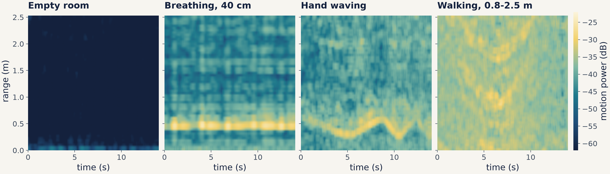
  <br><sub>What the laptop sees: echo power that changes over time, by range, for the four recorded activities (same colour scale throughout).</sub>
</p>

<table align="center">
  <tr>
    <td align="center"><b>4.3 cm</b><br><sub>range resolution</sub></td>
    <td align="center"><b>16 ms</b><br><sub>per channel snapshot</sub></td>
    <td align="center"><b>0.18 /min</b><br><sub>mean breathing deviation<br>from the cue, held out</sub></td>
    <td align="center"><b>0.998</b><br><sub>activity macro-F1,<br>leave-one-session-out</sub></td>
    <td align="center"><b>24 k</b><br><sub>CNN parameters,<br>1.8 ms per window</sub></td>
  </tr>
</table>

---

## Contents

- [The idea](#the-idea)
- [Part 1: the acoustic OFDM link](#part-1-the-acoustic-ofdm-link)
- [Part 2: from link to radar](#part-2-from-link-to-radar)
  - [Sounder design](#sounder-design) · [Hardware check](#does-a-laptop-work-as-a-radar) · [Dataset](#dataset)
  - [Breathing](#breathing-rate) · [Activity classification](#presence-and-activity-classification) · [Stress test](#stress-test-noise-and-window-length)
- [What I would not trust](#what-i-would-not-trust)
- [Quick start](#quick-start) · [Repository layout](#repository-layout) · [Credits](#credits)

## The idea

Sound in air at 8 kHz has a wavelength of **4.3 cm**, almost exactly the wavelength of a
**7–8 GHz UWB radar** in free space. Displacement changes echo phase in the same way in both,
so chest motion, phase wrapping and micro-Doppler look alike. Sound is a million times slower
than radio, so a few kilohertz of audio bandwidth give centimetre range bins. The laptop is
therefore a desk-sized scale model of a UWB people-sensing radar, and it needs no extra
hardware.

The project grew out of a course project. **Part 1** is a working acoustic OFDM modem
(loudspeaker to microphone) built by a team of three. It worked well on static channels and
**broke as soon as the microphone moved**: centimetres of motion rotate the phase by a full
cycle. **Part 2** turns that failure into the signal. The same transmitter and receiver
front end now measure how the room's echoes change, which is exactly what a radar does.

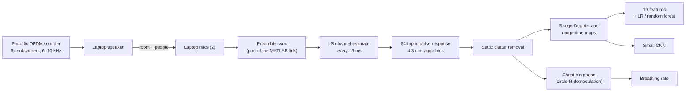

---

## Part 1: the acoustic OFDM link

*EPFL EE-442 Wireless Receivers, Group 20: Enric Guasch Mesià, Joelle Alachkar, Petar Damjanovic.
Original MATLAB code and the full report are in [`ofdm_link/`](ofdm_link/).*

A complete OFDM modem that sends random bits and images through the air at 48 kHz: 512 QPSK
subcarriers in a 2 kHz band around 8 kHz, a 128 ms cyclic prefix, an RRC-shaped BPSK preamble
for frame sync, least-squares channel estimation with impulse-response truncation, and three
phase trackers (decision-directed, Viterbi–Viterbi common phase, per-subcarrier Viterbi–Viterbi).

<p align="center">
  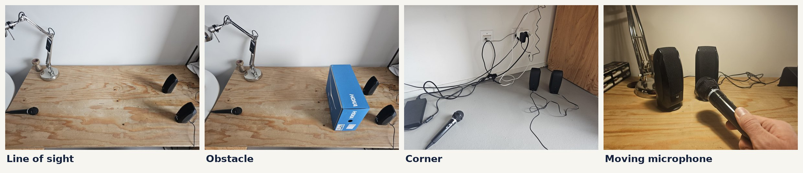
</p>

| Result | Value |
|---|---|
| Static line of sight, 30 cm | **0 errors in 10,240 bits** (bounds BER below about 3 × 10⁻⁴) |
| Peak-to-average power, image payload | 28.0 dB → **13.0 dB** with XOR whitening (interleaving: 27.9 dB), audible clipping gone |
| Phase drift, emulator | Viterbi–Viterbi kept lock to symbol 44, decision-directed to 37; all lose lock past π/4 per symbol |
| Spectral efficiency | 1.31 bit/s/Hz as built; a prefix sized to the measured 2.5 ms echoes would give 1.92 (computed, not tested over the air) |
| **Moving microphone** | **About 50 % bit errors** with one training symbol, about 5–40 % even with frequent retraining |

<p align="center">
  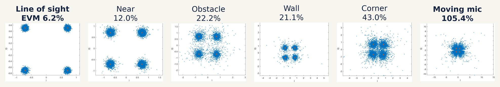
  <br><sub>Received constellations, ranked by error-vector magnitude. Every static scenario decoded without errors; the moving microphone did not.</sub>
</p>

---

## Part 2: from link to radar

### Sounder design

The preamble, pulse shaping and frame synchroniser of the link are kept, and the Python port is
checked sample for sample against the original MATLAB (`tests/test_port.py`). The data symbols
are replaced by one OFDM symbol repeated without a cyclic prefix. Each subcarrier sits on an
exact FFT bin of the 768-sample period, so **every 16 ms window of the recording is a cyclic copy**
and yields a full channel estimate.

| Parameter | Value | Why |
|---|---|---|
| Subcarriers | 64 × 62.5 Hz, 6–10 kHz | Centred on the link's 8 kHz carrier, above most room noise |
| Phases | Newman (quadratic) | Flat spectrum with a crest factor under 6 dB, so the speaker is not driven into clipping |
| Snapshot rate | 62.5 per second (16 ms) | Fast enough for walking: unambiguous speed ±0.67 m/s |
| Range bin / unambiguous range | c / 2B = **4.3 cm** / 2.74 m | Covers a desk and the space in front of it |
| Receiver | LS per subcarrier → 64-tap impulse response, aligned on the direct speaker-to-mic path | Speaker and mics share one audio clock, so the direct-path phase holds to 0.4° |

### Does a laptop work as a radar?

A scripted go/no-go session (`scripts/go_no_go.py`) answered that before any data collection.

| Check | Result (mic 1) |
|---|---|
| Empty room, static | In-band SNR 80 dB, direct-path phase jitter **0.4°**, clutter floor −48.5 dB |
| Book at 30 cm, then 60 cm | Detected at 34 and 60 cm: **25.7 cm apart** (true 30 cm, one range bin is 4.3 cm) |
| Book pulled on a string from 30 to 70 cm | Tracked from 21 to 69 cm |
| Paced breathing, 15/min cue, 40 cm | **15.4/min** |

<p align="center">
  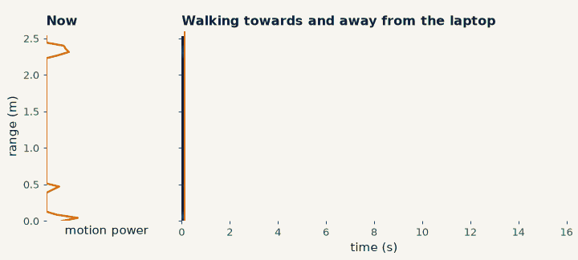
  <br><sub>Walking between 0.8 and 2.5 m: the range profile right now (left) and its history (right).</sub>
</p>

<p align="center">
  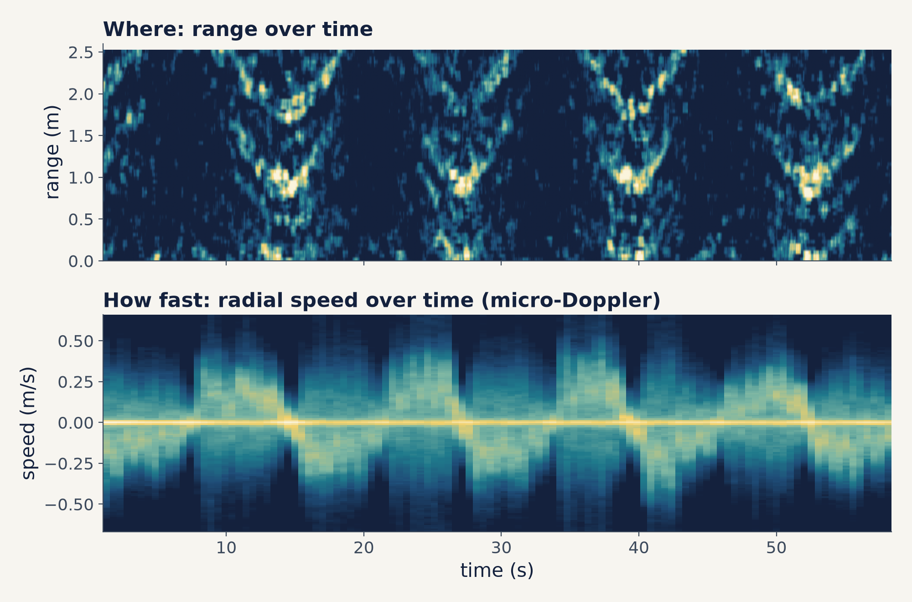
  <br><sub>A full minute of walking. Range shows <i>where</i> the person is; the Doppler spectrum of the same echoes shows <i>how fast</i>: approach and retreat at about ±0.3 m/s, with the limbs spreading around them.</sub>
</p>

### Dataset

Four sessions of seven scripted steps each, recorded with an interactive collector
(`scripts/collect.py`) that checks every capture on the spot so a bad take can be redone:

| Step | Duration | Class |
|---|---|---|
| Empty room (operator outside) | 60 s | empty |
| Sitting still, breathing normally | 60 s | still |
| Paced breathing at 40, 70 and 100 cm, 10/15/20 per minute in a Latin square | 3 × 40 s | still |
| Walking between 0.8 and 2.5 m | 60 s | walking |
| Hand waving at 30–60 cm while seated | 60 s | waving |

**28 captures, 24 minutes, one person, one room.** A rising and falling tone at 440–660 Hz, far
below the sounding band, paces the breathing. The recordings themselves are not published.

### Breathing rate

A deep breath moves the chest by 2–3 cm. At a 4.3 cm wavelength that **wraps the echo phase**: the
I/Q points travel more than half a circle, and a straight-line projection reads every breath
twice. The estimator fits a circle to the I/Q trace and takes the angle around it. Mmwave
vital-sign radars meet the same problem at 5 mm wavelength.

<p align="center">
  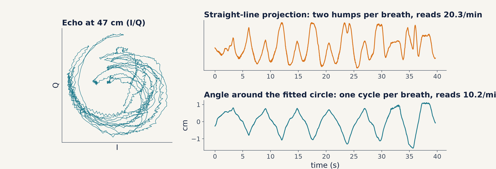
</p>

The final estimator votes across the four strongest range bins and two demodulators, drops
spectrally impure candidates and resolves the f/2f ambiguity towards f. It was **frozen after
tuning on sessions 1–2** (`radar/processing.py`, sha256 `0473e78c…`) and only then scored on sessions 3–4.

<table>
  <tr>
    <td width="58%">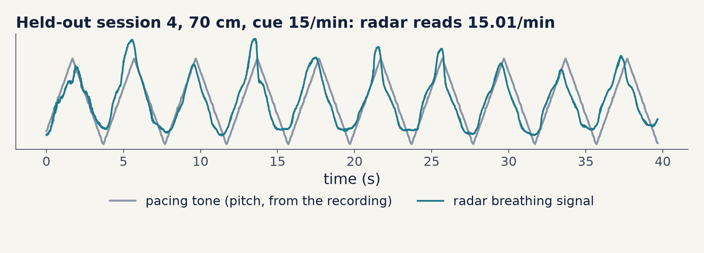</td>
    <td width="42%">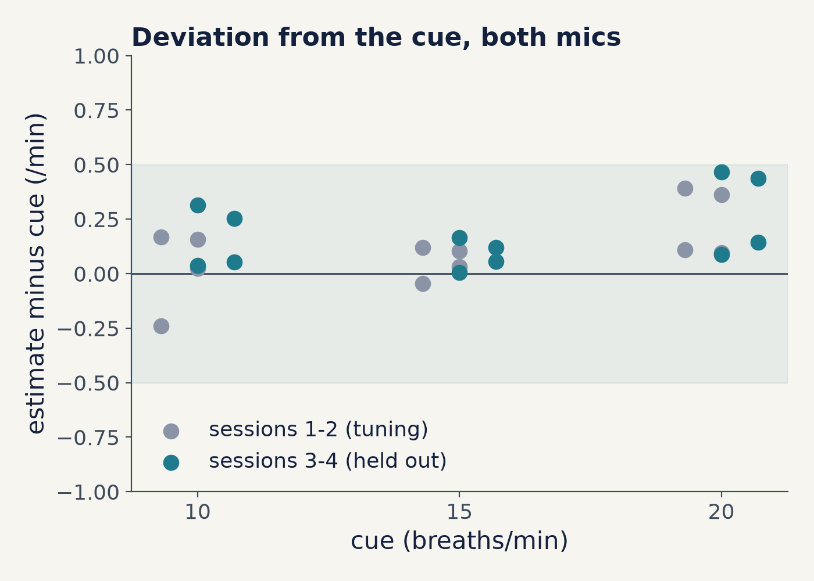</td>
  </tr>
</table>

| Deviation from the cue | Captures × mics | Mean abs | Max | Within 0.5/min |
|---|---|---|---|---|
| Tuning (sessions 1–2) | 12 | 0.15 /min | 0.39 | 100 % |
| **Held out (sessions 3–4)** | 12 | **0.18 /min** | 0.47 | **100 %** |

The cue is what the person *tried* to follow, so these numbers bound the tracker error from
above. `scripts/breathing_check.py` separates the two sources. The tone's own pitch, recovered
from the same recordings and run through the same estimator, reads 10.000 / 15.000 / 20.000 per
minute (maximum error 0.0002). The phase of the breathing drifts ahead of the tone by
+0.14 /min on average, which matches the radar's +0.14 /min offset. **Most of the
deviation is the person running slightly ahead of the tone**, not the tracker.

### Presence and activity classification

Inputs are 4.1 s windows (256 snapshots, 1 s hop, 1300 windows) from both mics. Evaluation is
**leave-one-session-out**: train on three sessions, test on the fourth, all four rotations.

| Model | Input | Macro-F1 | Recall empty / still / walking / waving |
|---|---|---|---|
| Majority class | – | 0.165 | 0 / 1 / 0 / 0 |
| Logistic regression | motion energy only | 0.556 | 1.00 / 0.42 / 0.76 / 0.22 |
| Logistic regression | 10 hand-crafted range/Doppler features | 0.995 | 1.00 / 1.00 / 1.00 / 0.98 |
| Random forest | 10 hand-crafted range/Doppler features | 0.997 | 1.00 / 1.00 / 1.00 / 0.99 |
| **Small CNN** (24 k params, 3 seeds) | range-Doppler + range-time maps | **0.998** | 1.00 / 1.00 / 1.00 / 0.99 |

<p align="center">
  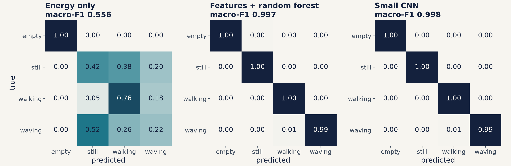
</p>

- **Presence is easy.** Every occupied capture sits more than 20 dB above the empty room, and one
  energy threshold (learned per fold at about −30 dB) separates them perfectly.
- **Activities are not about energy.** Sitting still, waving and walking overlap in power. What
  separates them is *where* and *how fast* things move: the slow-motion fraction, range extent and
  fast-motion fraction are the top random-forest features.
- **This is a ceiling, not a benchmark.** With one person, one room and four very different
  activities, the CNN cannot be told apart from the hand-crafted features here. The stress test
  below is where they start to differ.

### Stress test: noise and window length

Complex white noise was added to the measured impulse responses before windowing, from −30 dB to
0 dB relative to each capture's total received power. For scale, the motion of a seated person sits
at about −23 dB and walking at about −18 dB. The models were retrained at every level.

<p align="center">
  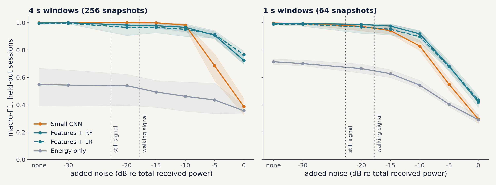
</p>

- **Coherent integration does the work.** With 4 s windows every structured model still scores
  ≥ 0.95 at −10 dB, where the noise is 8 dB stronger than the walking signal. Averaging 256
  snapshots gives about 24 dB of processing gain.
- **CNN vs features depends on the regime.** The CNN is the most robust model down to −10 dB,
  then collapses (0.69 at −5 dB, 0.39 at 0 dB), while the features degrade gracefully (0.91, 0.77).
  The features hard-code averaging over the whole map; a CNN trained from scratch on about 1000
  windows has not learned it.
- **Window length buys about 5 dB.** 4 s windows hold any given score about 5 dB deeper into the
  noise than 1 s windows, close to the 6 dB expected from 4× longer integration.

---

## What I would not trust

- **One person, one room, scripted activities.** Nothing here tests a new room, a new person,
  several people or subtler classes. Treat the classification numbers as an upper bound.
- **Breathing ground truth is a pacing tone**, not a chest belt. The breathing check makes it very
  likely that the tracker is good to well under 0.5 /min, but it does not prove it.
- **The breathing range bin sometimes sits further out than the chest** (47 cm for a 40 cm chest
  in session 1). Slant range to the torso or multipath are the suspects; this is still open.
- **Synthetic noise** in the stress test is white and Gaussian, not real interference, and there
  is one CNN seed per condition.
- From Part 1: the cyclic-prefix sweep explanation in our report was wrong (every prefix was
  over 10× the echo spread, so the differences were trial noise), and the preamble detection
  threshold was computed but never used.

## Quick start

```bash
git clone https://github.com/enricguaschmesia-lab/laptop-acoustic-radar.git
cd laptop-acoustic-radar
python -m venv .venv
source .venv/bin/activate          # Windows: .venv\Scripts\activate
pip install -e ".[ml,dev]"         # or: pip install -r requirements.txt && pip install -e .
pytest -q
```

**No sound needed.** These run on a built-in room simulator:

```bash
python scripts/go_no_go.py --simulate                 # hardware check on simulated captures
python scripts/collect.py --session 1 --simulate      # a full simulated session
python scripts/build_windows.py --simulated
python scripts/train_eval.py --data data/processed/windows_sim.npz
```

**With your own laptop.** These play the sounder through the speakers, and only after you press Enter:

```bash
python scripts/passive_check.py --seconds 15          # level, SNR and stability of a static scene
python scripts/go_no_go.py                            # books, a pulled book and paced breathing
python scripts/collect.py --session 1                 # one session of the dataset protocol (4 in total)
```

Then reproduce the analysis on your recordings:

```bash
python scripts/build_windows.py      # windows, maps and features   -> data/processed/
python scripts/train_eval.py         # leave-one-session-out models -> results/ml/
python scripts/breathing_check.py    # tone and phase-drift check   -> results/breathing/
python scripts/stress_test.py        # noise and window length      -> results/stress/
python scripts/make_figures.py       # the figures in this README   -> docs/figures/
```

Developed and tested on Windows 11 with WASAPI in shared mode. On other systems the default audio
devices are used, which should work but is untested. The laptop needs a speaker that reaches
10 kHz and microphones on the same audio clock.

## Repository layout

```
laptop-acoustic-radar/
├── radar/                    Python package
│   ├── config.py             sounder parameters (SounderConfig)
│   ├── waveform.py           PN sequence, RRC preamble, OFDM sounding symbol, pacing tone
│   ├── sync.py               matched filter and frame sync (port of the MATLAB link)
│   ├── processing.py         channel estimation, clutter removal, range-Doppler, breathing (frozen)
│   ├── features.py           windowed maps and hand-crafted features
│   ├── models.py             small CNN, augmentation, training
│   ├── evaluation.py         presence threshold, leave-one-session-out helpers
│   ├── audio_io.py           simultaneous play/record, capture files
│   ├── protocol.py, qc.py    dataset protocol and per-capture quality check
│   ├── diagnostics.py        static-scene hardware checks
│   └── sim.py, scenes.py     room simulator and simulated protocol scenes
├── scripts/                  command-line entry points (see Quick start)
├── tests/                    25 tests, including a sample-exact check against MATLAB outputs
├── results/                  summary metrics behind the README (JSON)
├── docs/
│   ├── figures/              README figures
│   └── lab_notebook.md       how the project developed, session by session
└── ofdm_link/                Part 1: original MATLAB code and the course report (PDF)
```

## Credits

**Part 2** (the radar, dataset, models and everything in `radar/`, `scripts/` and `tests/`) is my own work.

**Part 1** was a team project for EPFL EE-442 *Wireless Receivers: Algorithms and Architectures*
by **Enric Guasch Mesià, Joelle Alachkar and Petar Damjanovic** (Group 20). The audio framework
helpers in `ofdm_link/matlab` (`rrc.m`, `ofdmlowpass.m`, the resampling functions) come from
the course's framework, and the course's channel emulator is not redistributed.

Released under the [MIT License](LICENSE).
